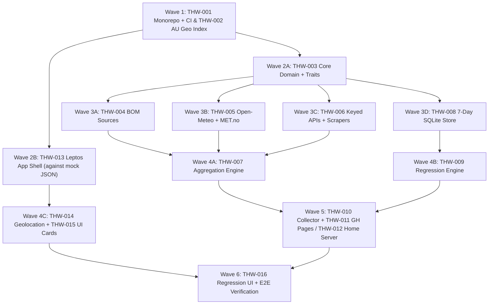

# Agent Factory & Subagent Execution Plan

This project uses **Spec-Driven Development (SDD)** so an agent factory—or coordinated parallel subagents—can implement TurtleHeavyWeather incrementally with deterministic verification.

---

## 1. Spec-Driven Ticket Workflow

1. **Source of Truth:** Every piece of work lives in `planning/tickets/THW-XXX-*.md` and is tracked in `planning/BOARD.md`.
2. **Before Coding:** An implementing agent reads:
   - The ticket file (`THW-XXX`)
   - Referenced architecture/API specs in `docs/`
   - Upstream completed dependencies listed in the ticket frontmatter
3. **Claiming & WIP Tracking:** Move ticket `status` from `ready` -> `in_progress` in both the ticket file and `planning/BOARD.md`.
4. **Implementation & Tests:** Write code + unit/integration tests matching the ticket's **Acceptance Criteria** and **Test Plan**. Never test against live external APIs in CI; use recorded fixtures.
5. **Verification Gate:** Run `cargo fmt --check`, `cargo clippy --all-targets -- -D warnings`, `cargo test --workspace`, and (for frontend tickets) `trunk build` / WASM check.
6. **Completion:** Update ticket `status: done`, check off acceptance criteria, record test evidence in the ticket's `## Execution Log`, and update `planning/BOARD.md`.

---

## 2. Subagent Build-Out Plan (Parallel Waves)

Because the workspace is cleanly modularized along crate and vertical boundaries, subagents can work in **parallel waves** using isolated workspaces (`share` / `branch`) once dependencies merge.

### Recommended Subagent Roles & Isolation

| Wave | Ticket(s) | Subagent Role | Workspace Mode | Output / Merge Artifact |
| :--- | :--- | :--- | :--- | :--- |
| **Wave 1** | `THW-001`, `THW-002` | `Workspace & CI Architect` | `inherit` (sequential foundation) | Cargo workspace, `.github/workflows/ci.yml`, AU suburb/postcode + mesh dataset |
| **Wave 2** | `THW-003` | `Core Domain Engineer` | `share` | `thw-core` types, `WeatherSource` trait, Steadman feels-like helper, JSON contracts |
| **Wave 2** | `THW-013` | `Leptos Frontend Shell` | `share` | `frontend/` Cargo/Trunk setup, `WeatherDataClient` trait, mock fixture mode, suburb/postcode picker |
| **Wave 3** | `THW-004` | `BOM Integration Engineer` | `share` | BOM JSON obs + FTP XML + optional `api.weather.bom.gov.au` adapters + wiremock tests |
| **Wave 3** | `THW-005` | `Open Weather API Engineer` | `share` | Open-Meteo (BOM ACCESS + ECMWF + GFS) + MET Norway adapters + wiremock tests |
| **Wave 3** | `THW-006` | `Scraper & Keyed API Engineer` | `share` | WeatherAPI/PirateWeather/OWM/Tomorrow adapters + robots/ToS audit + compliant scrapers |
| **Wave 3** | `THW-008` | `Storage Engineer` | `share` | `thw-store` SQLite migrations, 7-day retention pruning, WAL config, unit tests |
| **Wave 4** | `THW-007` | `Aggregation Engineer` | `share` | Weighted consensus engine (Feels-Like, Temp, Rain verdict, spread/confidence) |
| **Wave 4** | `THW-009` | `Regression Engineer` | `share` | Forecast-vs-actuals matcher, MAE/RMSE/Bias/Brier calculator |
| **Wave 4** | `THW-014`, `THW-015` | `Leptos UI Feature Engineer` | `share` | Browser `navigator.geolocation`, Best-Estimate Hero Card, Collapsible Source Accordions |
| **Wave 5** | `THW-010`, `THW-011`, `THW-012` | `Platform & Deployment Engineer` | `share` | `thw-collector` CLI, GitHub Pages exporter/workflow AND/OR `thw-server` Axum + Caddy/Docker |
| **Wave 6** | `THW-016` | `QA & Regression UI Engineer` | `inherit` | Regression diagnostics UI tab, cross-crate integration tests, Playwright/WASM E2E smoke |

### Coordination Rules for Subagents
1. **Contract-First Merging:** Merge `THW-003` (`thw-core` schemas) before Wave 3/4 subagents finalize adapter payloads so every crate compiles against one canonical type set.
2. **Dedicated Files Per Subagent:** Each Wave 3 source subagent owns its own module file (`thw-sources/src/bom.rs`, `open_meteo.rs`, `met_no.rs`, `keyed.rs`, `scraper.rs`) to minimize merge conflicts.
3. **Independent Verification Subagent:** After each wave merges, run a dedicated read-only/test verifier subagent (`cargo test --workspace`, `cargo clippy`, `trunk build`) before kicking off the next wave.
