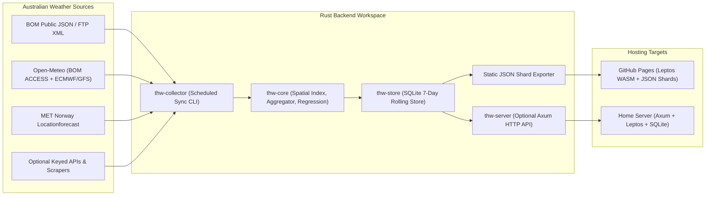

# System Architecture

## 1. Design Principles

1. **Shared Rust Core, Dual Deployment Target:** Keep 90%+ of business logic in pure Rust crates (`thw-core`, `thw-sources`, `thw-store`) so the same collector pipeline can emit static JSON for **GitHub Pages** or back a live **Home Server** API without rewriting logic.
2. **Station/Mesh-Based Collection, Suburb-Level UX:** Australia has ~15,000+ suburbs and ~3,000 postcodes, but weather models and BOM stations operate on spatial grids and ~600–800 Automatic Weather Stations (AWS). We collect on a curated **Australian Station & Regional Hub Mesh** (~100–250 representative nodes) and map every suburb, postcode, and GPS coordinate to its nearest node(s) via Haversine distance.
3. **Resilient Source Isolation:** Every weather source implements a uniform async `WeatherSource` trait returning normalized `SourceReport` structs with explicit units (`°C`, `mm`, `km/h`, `%`) and timestamps. A failing or rate-limited source never fails the whole sync or UI render.
4. **Lightweight Rolling State (7 Days):** No multi-year warehouse. Store only recent forecasts (e.g., 7-day horizon), the last 7 days of historical forecast snapshots + actual observations, and computed regression scores.
5. **No User Accounts:** Zero auth, zero cookies, zero personal data stored server-side. Browser geolocation stays client-side (`navigator.geolocation` -> nearest node lookup).

## 2. High-Level Component Diagram



## 3. Aggregation ("Best Estimate") Pipeline

For a given mesh node `N` and target timestamp `t`:

1. **Unit Normalization:** Convert all source readings to SI/Australian standard (`temp_c`, `feels_like_c`, `rain_prob_pct`, `rain_mm_1h`, `rain_mm_24h`, `wind_kmh`, `humidity_pct`).
   - If a source omits `feels_like_c`, compute Australian Apparent Temperature (BOM Steadman formula using `T`, water vapour pressure from RH, and wind speed) in `thw-core` so every source contributes consistently—while clearly flagging synthesized vs native feels-like values.
2. **Staleness Filtering:** Discard or down-weight reports older than a configurable freshness threshold (e.g., >3h for observations, >12h for forecasts).
3. **Weighted Consensus:**
   - Compute weighted mean / trimmed mean across available sources using configurable per-source weights (defaulting to higher weight for BOM/BOM-ACCESS in Australia, later tunable via regression outputs).
   - Lead UI metrics:
     - **Feels-Like Temperature (`°C`)** + spread (`min..max` across sources)
     - **Regular Temperature (`°C`)** + spread
     - **Rain Decision (`Will it rain?`)**: synthesized categorical verdict (`Dry`, `Possible Showers`, `Rain Likely`, `Raining Now`), consensus probability `%`, and expected `mm` range.
4. **Per-Source Transparency:** Preserve every raw normalized `SourceReport` alongside the aggregate so the frontend renders each source inside its own collapsible submenu.

## 4. Monorepo Directory Plan

```text
turtleheavyweather/
├── Cargo.toml                 # (Planned) Rust workspace root
├── .github/workflows/
│   ├── ci.yml                 # PR tests, fmt, clippy, wasm check
│   └── sync-and-deploy.yml    # Optional scheduled GitHub Actions collector + Pages deploy
├── backend/
│   └── crates/
│       ├── thw-core/
│       ├── thw-sources/
│       ├── thw-store/
│       ├── thw-collector/
│       └── thw-server/
├── frontend/
│   ├── Cargo.toml
│   ├── Trunk.toml
│   ├── index.html
│   └── src/
├── docs/
└── planning/
```
